# Awesome Recommendation Systems & Preference Profiling

<p align="center">
  
</p>

<p align="center">
  <a href="https://github.com/ishandutta2007/Awesome-Awesome-Awesome"></a>
  <a href="https://discord.gg/jc4xtF58Ve"></a>
  <a href="https://github.com/ishandutta2007/Awesome-Awesome-Awesome"></a>
  <a href="https://github.com/ishandutta2007/Awesome-Recommendation-Systems-Preference-Profiling"></a>
  <a href="https://github.com/ishandutta2007/Awesome-Recommendation-Systems-Preference-Profiling"></a>
  <a href="https://github.com/ishandutta2007/Awesome-Recommendation-Systems-Preference-Profiling/blob/main/README.md#how-to-contribute"></a>
  <a href="https://github.com/ishandutta2007"></a>
</p>

> 🎯 A curated directory and benchmark of industry-leading **Recommendation Systems**, **Personalization Platforms**, **Collaborative Filtering Suites**, **Neural Ranking Models**, and **User Preference Profiling** engines—spanning enterprise SaaS platforms and state-of-the-art open-source repositories.

---

## 📑 Table of Contents

- [🌐 Sector Overview & Market Dynamics](#-sector-overview--market-dynamics)
- [☁️ SaaS & Hosted Personalization Platforms](#️-saas--hosted-personalization-platforms)
- [💻 Open-Source Recommendation Systems & Frameworks](#-open-source-recommendation-systems--frameworks)
- [🏗️ Architectural Patterns & Composable Stacks](#️-architectural-patterns--composable-stacks)
- [🤝 How to Contribute](#-how-to-contribute)
- [💖 Support](#-support)
- [⭐ Star History](#-star-history)
- [⚠️ Disclaimer](#️-disclaimer)

---

## 🌐 Sector Overview & Market Dynamics

The global recommendation systems and personalization engine market is valued at approximately **$8.2 Billion to $9.2 Billion** in 2025 and is projected to expand to **$33 Billion to $38 Billion+ by 2030**, exhibiting a Compound Annual Growth Rate (CAGR) of ~33–36%. 📈

The market displays a **hybrid structural dynamic**:
* 🏢 **High Concentration at Core Cloud Infrastructure**: Foundation-level storage, vector indexing, and managed training backbones are heavily consolidated among hyper-scalers (Amazon Web Services, Google Cloud Platform, Microsoft Azure).
* 🧩 **High Fragmentation at the Application & Modular Personalization Layer**: Front-facing retail discovery, search-and-recommend modules, headless commerce personalization, and preference-learning tooling remain highly fragmented across specialized mid-market and enterprise SaaS providers competing on domain-specific merchandising logic, zero-party preference modeling, and low-latency inference.

---

## ☁️ SaaS & Hosted Personalization Platforms

Enterprise hosted platforms provide managed end-to-end event collection, automated catalog ingestion, model training, real-time inferencing APIs, and merchandising rule interfaces.

The table below is sorted by **Company Size / Valuation / Market Cap** in descending order: 📊

| Platform | Company Size (Valuation / Market Cap / Revenue) | Starting Tier Pricing | Free Tier / Trial Limits | Description & Capabilities |
| :--- | :--- | :--- | :--- | :--- |
| **[Amazon Personalize](https://aws.amazon.com/personalize/)** | ~$2.2 Trillion (Amazon Market Cap) | Pay-as-you-go: $0.05/GB ingestion, $0.24/training-hour (legacy) or $0.06/1K interactions (v2), $0.067/TPS-hour real-time recommendations | 2-month Free Trial: 20 GB data processing/storage, 5M interactions or 100 training hours, 50,000 v2 or 180,000 legacy recommendation queries per month | Managed ML personalization service powered by AWS, providing real-time item recommendations, user personalization, and personalized re-ranking. |
| **[Google Recommendations AI](https://cloud.google.com/retail/docs/recommendations-overview)** *(Vertex AI Search / Retail)* | ~$2.1 Trillion (Alphabet Market Cap) | Pay-as-you-go: $0.27 per 1,000 prediction requests; $2.50/training node hour and $0.25/tuning node hour | 90-day GCP Free Trial with $300 billing credits for compute, storage, catalog ingestion, and prediction testing | High-accuracy Google Cloud retail recommendation service drawing on Google's expertise in deep retrieval and context-aware ranking. |
| **[Dynamic Yield](https://www.dynamicyield.com/)** *(A Mastercard Company)* | ~$325 Million (Acquisition Price by Mastercard / parent $450B+ Market Cap) | Custom quote-based: baseline contracts start at ~$35,000/year (~$2,916/month) based on Monthly Active Visitors (MAV) | No permanent free tier; tailored product demo and pilot proof-of-concept (POC) available upon sales consultation | Enterprise personalization and experience optimization engine handling omnichannel recommendations, A/B testing, and rule-based merchandising. |
| **[Algolia Recommend](https://www.algolia.com/products/recommendations/)** | $2.25 Billion (Valuation at Series D) / ~$240M ARR | Grow Plan pay-as-you-go: $0.60 per 1,000 recommendation requests (Search add-on at $0.50/1K requests, $0.40/1K records) | Free Plan: 5,000 Recommend requests/month, 10,000 search requests/month, and 50,000 records included with no credit card required | Machine-learning recommendation API delivering related products, frequently bought together bundles, and personalized discovery with ultra-low latency. |
| **[Bloomreach](https://www.bloomreach.com/)** | $2.2 Billion (Valuation at Series F) / $260M+ ARR | Custom quote-based: specialized discovery entry tiers start at ~$19,000/year (~$1,583/month); enterprise deployments start at ~$60,000+/year | No permanent free tier; guided 1-on-1 enterprise sandbox demo and data evaluation session available on request | E-commerce personalization suite combining Loomi AI, customer data platform (CDP), real-time search, and individualized product recommendations. |
| **[Constructor.io](https://constructor.io/)** | $550 Million (Valuation at Series B) / ~$30M+ ARR | Custom quote-based: enterprise retail contracts start at ~$24,000/year (~$2,000/month) based on query and SKU volume | No permanent free tier; "The Proof Schedule" offers a 4-week non-intrusive revenue lift and search/recommendation assessment | AI-native product discovery engine purpose-built for enterprise retailers, using clickstream feedback loops to maximize revenue per session. |
| **[Coveo](https://www.coveo.com/)** | ~$350 Million (Market Cap on TSX: CVO) / $148M Revenue | Base tier configurations start at ~$600/month; enterprise multi-module contracts start at ~$30,000+/year | 14-day Free Trial with no credit card required to test catalog indexing, connectors, and relevance models | Enterprise AI search and recommendation engine providing relevance-augmented ranking across commerce, customer service portals, and digital workplaces. |
| **[Clerk.io](https://clerk.io/)** | ~$15 Million ARR (Bootstrapped / Private) | Modular pricing starting at ~$99/month per module (e.g., Search, Recommendations, Email, Audience) | 14-day Free Trial with guided onboarding and real-store data synchronization | Plug-and-play e-commerce personalization engine for growing webshops, automating product carousels, cross-selling, and email merchandising. |
| **[Klevu](https://www.klevu.com/)** | ~$10 Million ARR / ~$18M Total Funding | AI Recommendations module starts at ~$449/month; AI Site Search starts at ~$649/month on Shopify / BigCommerce | 14-day Free Trial available across supported e-commerce platforms to test indexing and merchandising tools | Headless-ready AI search, merchandising, and recommendation engine designed to improve e-commerce catalog discovery and average order value. |
| **[Recombee](https://www.recombee.com/)** | ~$5.3 Million ARR (Bootstrapped / Profitable) | Standard Plan starts at $99/month for up to 100K recommendations & 100K interactions | Free Plan: Permanent $0/month for up to 100,000 recommendation requests, 100,000 interactions, 20,000 items, and 20,000 active users; 30-day Pro trial | Real-time AI recommendation API supporting collaborative filtering, content-based deep models, and graphical UI for business rules. |
| **[Crossing Minds](https://crossingminds.com/)** | ~$14.5 Million Total Raised (Acquihired / Private) | Custom quote-based: tailored enterprise contracts based on user catalog size and API call volume | No permanent free tier; customized live architectural demo and pilot testing available upon request | Context-aware and cookieless recommendation API utilizing graph neural networks and zero-party interactions for privacy-first personalization. |

---

## 💻 Open-Source Recommendation Systems & Frameworks

The open-source community provides production-grade libraries, deep neural ranking architectures, and scientific benchmarking environments. 🛠️

The table below is sorted by **GitHub Star Count** in descending order: ⭐

| Repository | GitHub Stars | Core Algorithms & Focus | Language & Stack |
| :--- | :--- | :--- | :--- |
| **[Recommenders](https://github.com/recommenders-team/recommenders)** | [](https://github.com/recommenders-team/recommenders/stargazers) | Comprehensive suite of production-ready recommendation algorithms (SAR, NCF, DKN, LightGCN, VAE), evaluation benchmarks, and deployment patterns. | Python, PyTorch, TensorFlow, Spark |
| **[DeepCTR](https://github.com/shenweichen/DeepCTR)** | [](https://github.com/shenweichen/DeepCTR/stargazers) | Modular library of deep-learning Click-Through-Rate (CTR) prediction models (DeepFM, xDeepFM, AutoInt, DCN, DIN, DIEN) for ranking and retrieval. | Python, TensorFlow, PyTorch (`DeepCTR-Torch`) |
| **[Feast](https://github.com/feast-dev/feast)** | [](https://github.com/feast-dev/feast/stargazers) | Open-source feature store powering real-time personalization, point-in-time correct training data generation, and low-latency online inference feature serving. | Python, Go, Redis, PostgreSQL |
| **[Surprise](https://github.com/NicolasHug/Surprise)** | [](https://github.com/NicolasHug/Surprise/stargazers) | Scikit-learn-compatible toolkit for explicit-feedback collaborative filtering, matrix factorization (SVD, SVD++), and classical recommendation baselines. | Python, Cython |
| **[LightFM](https://github.com/lyst/lightfm)** | [](https://github.com/lyst/lightfm/stargazers) | Hybrid matrix factorization model incorporating user and item metadata with collaborative feedback; optimized for implicit (WARP/BPR) and explicit feedback. | Python, C, Cython |
| **[RecBole](https://github.com/RUCAIBox/RecBole)** | [](https://github.com/RUCAIBox/RecBole/stargazers) | Unified, modular PyTorch recommender framework featuring 90+ algorithmic baselines (general, sequential, context-aware, knowledge-based) and 28+ benchmark datasets. | Python, PyTorch |
| **[PaddleRec](https://github.com/PaddlePaddle/PaddleRec)** | [](https://github.com/PaddlePaddle/PaddleRec/stargazers) | Large-scale distributed recommendation engine covering candidate retrieval, CTR ranking, multi-task learning, and heavy industrial workloads. | Python, C++, PaddlePaddle |
| **[DLRM](https://github.com/facebookresearch/dlrm)** | [](https://github.com/facebookresearch/dlrm/stargazers) | Meta's reference implementation of the Deep Learning Recommendation Model for CTR prediction, combining categorical embedding tables and dense bottom MLPs. | Python, PyTorch |
| **[Implicit](https://github.com/benfred/implicit)** | [](https://github.com/benfred/implicit/stargazers) | Ultra-fast collaborative filtering for implicit datasets using Alternating Least Squares (ALS), Bayesian Personalized Ranking (BPR), and logistic matrix factorization. | Python, Cython, CUDA, C++ |
| **[Spotlight](https://github.com/maciejkula/spotlight)** | [](https://github.com/maciejkula/spotlight/stargazers) | PyTorch-native recommendation algorithms covering explicit factorization, implicit sequence models (LSTM, CNN), and pooling models for next-item prediction. | Python, PyTorch |
| **[EasyRec](https://github.com/alibaba/EasyRec)** | [](https://github.com/alibaba/EasyRec/stargazers) | Alibaba's distributed recommendation framework supporting automated feature engineering, deep CTR architectures, multi-objective ranking, and model export. | Python, TensorFlow |
| **[TensorFlow Recommenders (TFRS)](https://github.com/tensorflow/recommenders)** | [](https://github.com/tensorflow/recommenders/stargazers) | End-to-end library for building two-tower candidate retrieval, feature interactions, deep ranking heads, and multi-task learning with TensorFlow Serving export. | Python, TensorFlow, Keras |
| **[Elasticsearch Learning to Rank (LTR)](https://github.com/o19s/elasticsearch-learning-to-rank)** | [](https://github.com/o19s/elasticsearch-learning-to-rank/stargazers) | Plugin that integrates machine-learned ranking models (LambdaMART, XGBoost, RankLib) directly into Elasticsearch/OpenSearch scoring pipelines. | Java, Elasticsearch, OpenSearch |
| **[FuxiCTR](https://github.com/reczoo/FuxiCTR)** | [](https://github.com/reczoo/FuxiCTR/stargazers) | Configurable and reproducible benchmark library for CTR prediction, featuring standardized data preprocessing and 40+ deep ranking model implementations. | Python, PyTorch |
| **[Cornac](https://github.com/PreferredAI/cornac)** | [](https://github.com/PreferredAI/cornac/stargazers) | Multimodal recommender system framework enabling comparative evaluations across collaborative filtering, visual, text, graph, and cross-domain modalities. | Python, Cython, C++ |
| **[NVIDIA Merlin](https://github.com/NVIDIA-Merlin/Merlin)** | [](https://github.com/NVIDIA-Merlin/Merlin/stargazers) | End-to-end GPU-accelerated recommendation platform featuring NVTabular (ETL preprocessing), Transformers4Rec (sequential models), and Triton inference deployment. | Python, CUDA, C++, PyTorch, TensorFlow |
| **[LensKit](https://github.com/lenskit/lkpy)** | [](https://github.com/lenskit/lkpy/stargazers) | Python toolkit for academic recommender systems research, reproducible offline experimentation, evaluation metrics, and pedagogical exploration. | Python, NumPy, SciPy |

---

## 🏗️ Architectural Patterns & Composable Stacks

Modern industrial personalization architectures separate recommendation pipelines into distinct stages: ⚙️

```
[User Events & Telemetry]
           │
           ▼
[Feature Store / Ingestion] ──────► (Feast / Redis / Kafka)
           │
           ▼
┌────────────────────────────────────────────────────────┐
│ 1. Candidate Retrieval (Retrieval / Two-Tower Models)   │
│    - Candidates: 10,000,000 items ➔ Top 1,000         │
│    - Stack: Implicit / TFRS / Faiss / Milvus / Qdrant  │
└──────────────────────────┬─────────────────────────────┘
                           │
                           ▼
┌────────────────────────────────────────────────────────┐
│ 2. Deep Ranking & Scoring (Heavy CTR Models)           │
│    - Candidates: Top 1,000 items ➔ Top 50              │
│    - Stack: DeepCTR / DLRM / LightFM / NVIDIA Merlin   │
└──────────────────────────┬─────────────────────────────┘
                           │
                           ▼
┌────────────────────────────────────────────────────────┐
│ 3. Re-ranking & Business Rules (Diversity / Diversity)  │
│    - Candidates: Top 50 items ➔ Top 10                 │
│    - Stack: Merchandising Rules / De-biasing / Filters │
└──────────────────────────┬─────────────────────────────┘
                           │
                           ▼
               [Personalized UI Display]
```

### 💡 Stack Recommendations by Use Case

* ⚡ **High-Speed Implicit Feedback at Scale**: Start with **[Implicit](https://github.com/benfred/implicit)** (ALS/BPR) or **[LightFM](https://github.com/lyst/lightfm)** for collaborative filtering baselines.
* 🧠 **Deep Two-Tower Retrieval & Neural Ranking**: Use **[TensorFlow Recommenders](https://github.com/tensorflow/recommenders)** or **[NVIDIA Merlin](https://github.com/NVIDIA-Merlin/Merlin)** for GPU-accelerated embedding lookup and real-time inferencing.
* 🔬 **Academic Research & Algorithm Benchmarking**: Leverage **[RecBole](https://github.com/RUCAIBox/RecBole)** for evaluating against 90+ standard models across unified dataset pipelines.
* 🗄️ **Production Feature Storage**: Pair **[Feast](https://github.com/feast-dev/feast)** with low-latency caches (Redis) to deliver fresh user interaction features to inference workers.
* 🛍️ **Turnkey Commerce Experience**: Choose managed platforms like **[Algolia Recommend](https://www.algolia.com/products/recommendations/)** or **[Recombee](https://www.recombee.com/)** when developer agility, pre-built merchandising UI, and managed SLA are required.

---

## 🤝 How to Contribute

We welcome community contributions! 🙌 To add a new platform, library, or benchmarking tool:

1. **Fork this repository** 🍴
2. **Add or edit entries in [README.md](file:///C:/Users/hp/Documents/Projects/Awesome-Recommendation-Systems-Preference-Profiling/README.md)**:
   - For SaaS tools: Include platform name, live URL, company size/valuation metric, exact starting tier price, and concrete free tier/trial limits.
   - For Open-Source libraries: Include repository name, link, social star badge with link to stargazers, core capabilities, and tech stack. Ensure table ordering matches sorting criteria (Valuation for SaaS, Stars for OSS).
3. **Verify formatting**: Ensure Markdown tables and links render cleanly.
4. **Submit a Pull Request** 🚀 with a brief summary of the added solution.

---

## 💖 Support

Thank you for visiting and using this repository! If you find this curated ecosystem helpful:

- ⭐ **Star this repository** to show your support and help others discover it!
- 🍴 **Fork and share** it with fellow ML engineers, product managers, and data scientists.
- ☕ If this project saved you time or aided your architectural research, consider buying a coffee or supporting ongoing open-source maintenance via the **[GitHub Sponsor Dashboard](https://github.com/sponsors/ishandutta2007)**!

---

## ⭐ Star History

[](https://star-history.dera.page/#ishandutta2007/Awesome-Recommendation-Systems-Preference-Profiling&type=date&legend=top-left)
[](https://www.star-history.com/#ishandutta2007/Awesome-Recommendation-Systems-Preference-Profiling&type=date&legend=top-left)

---

## ⚠️ Disclaimer

- 📌 This repository is a community-curated directory intended for research, evaluation, and engineering architecture planning; it does not constitute commercial endorsement.
- 🛡️ Recommender systems learn from historical user interaction data and can inadvertently amplify bias or popularity concentration; implement fairness, diversity, and privacy safeguards (GDPR/CCPA compliant telemetry) in production deployments.
